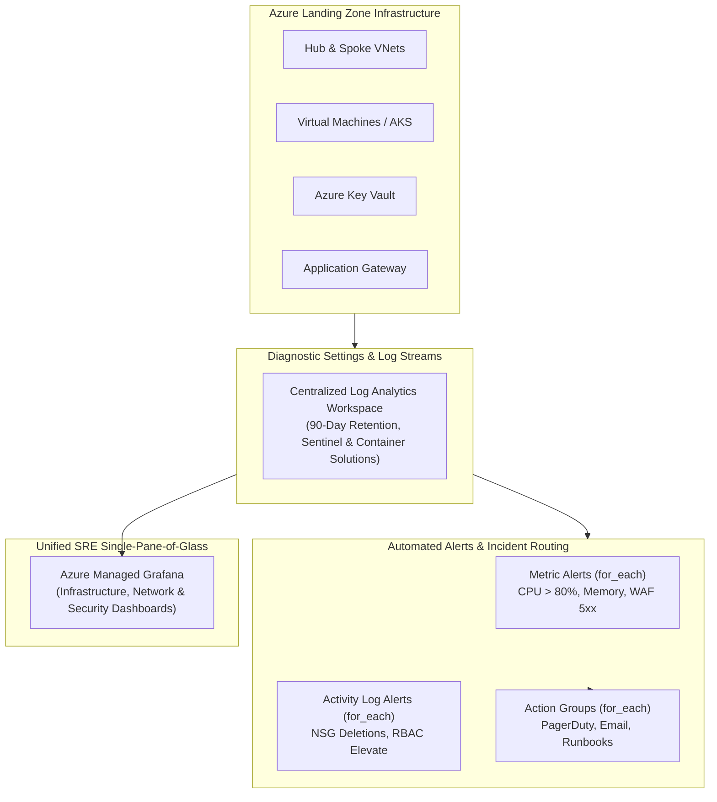

# 📊 Enterprise Azure Observability as Code

[](https://terraform.io)
[](https://azure.microsoft.com)
[](https://grafana.com)
[](https://developer.hashicorp.com)

Production-grade **Observability as Code** on **Microsoft Azure** architected by **Gunjan Kumar Gaurav** (Senior Cloud & DevSecOps Consultant). Automates the entire telemetry lifecycle: Log Analytics, multi-tier Action Groups, Metric Alerts, Activity Log Security Audits, and Azure Managed Grafana Dashboards as Code.

---

## 🏛️ Observability Architecture



---

## ⚡ Observability Capabilities Configured

| Component | Module | Implementation Details | Pattern |
|---|---|---|---|
| **Log Workspace** | [`modules/log_analytics`](./modules/log_analytics) | Centralized storage, retention, `SecurityInsights` + `ContainerInsights` | `for_each = var.solutions` |
| **Notification Groups** | [`modules/action_groups`](./modules/action_groups) | PagerDuty, DevOps on-call SMS, incident webhooks | `for_each = var.action_groups` |
| **Metric Telemetry** | [`modules/metric_alerts`](./modules/metric_alerts) | High CPU, memory saturation, Gateway 5xx, Key Vault latency | `for_each = var.metric_alerts` |
| **Security Auditing** | [`modules/activity_alerts`](./modules/activity_alerts) | NSG rule drops, administrative role assignments, unauthorized edits | `for_each = var.activity_alerts` |
| **Dashboards as Code** | [`modules/grafana`](./modules/grafana) | Azure Managed Grafana with committed JSON dashboards | Declarative JSON provisioning |

---

## 📂 Repository Layout

```text
├── versions.tf                        # Provider pins (AzureRM >= 3.116)
├── main.tf                            # Root orchestration calling all observability modules
├── outputs.tf                         # Log analytics & Grafana endpoints
├── modules/
│   ├── log_analytics/                 # Centralized workspace & OMS solutions
│   ├── action_groups/                 # Incident notification channels
│   ├── metric_alerts/                 # Performance degradation monitors
│   ├── activity_alerts/               # Security & administrative change monitors
│   └── grafana/                       # Azure Managed Grafana & JSON dashboards
│       └── dashboards/
│           └── azure-landing-zone-overview.json
└── README.md
```

---

## 🚀 Deployment Instructions

```bash
# 1. Initialize Terraform
terraform init

# 2. Plan execution
terraform plan -out=tfplan

# 3. Apply changes to Azure
terraform apply tfplan
```

---

## 👤 Author
**Gunjan Kumar Gaurav**  
*Senior Cloud & DevSecOps Consultant*  
[LinkedIn Profile](https://linkedin.com/in/gunjan-gaurav) • [GitHub](https://github.com/gunjankumargaurav7350)
